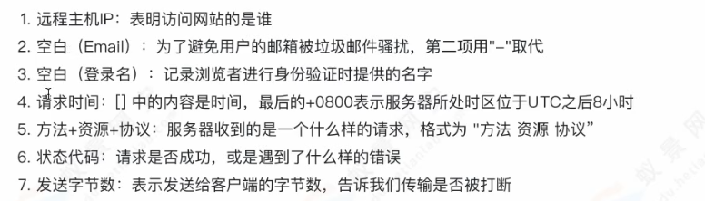
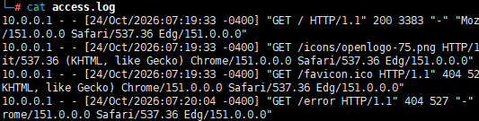

# 1，apache日志

windows：Apache\logs\

**主配置文件**：httpd.conf

```bash
access.log	#访问日志
error.log	#错误日志
```

Linux：/var/log/apache2/下

**主配置文件**：/etc/apache2/apache.conf

```bash
┌──(root㉿kali)-[/var/log/apache2]
└─# ll   
total 0
-rw-r----- 1 root adm 0 Mar 20  2026 access.log
-rw-r----- 1 root adm 0 Mar 20  2026 error.log
-rw-r----- 1 root adm 0 Mar 20  2026 other_vhosts_access.log
```

apache标准中规定了4类日志，分别为：

错误日志、访问日志、传输日志、Cookie日志。（其中传输日志、Cookie日志现已废弃）

------

> **access.log**





