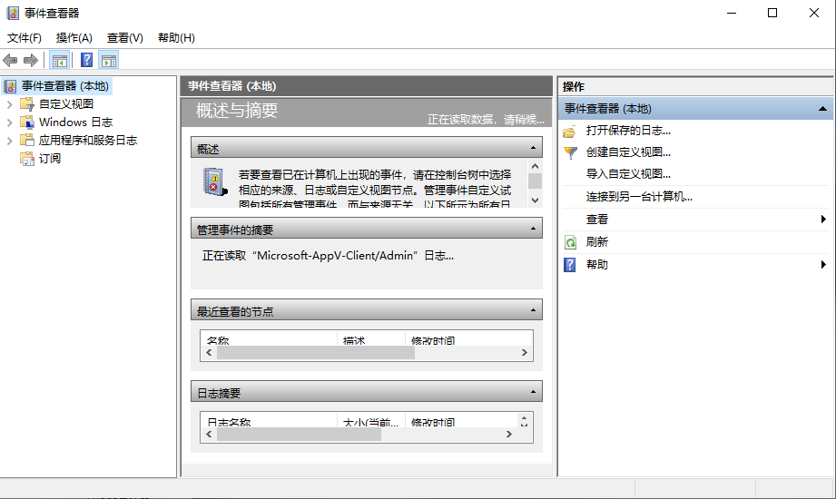
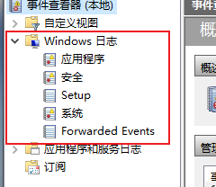

# 一、Windows日志

## 1，事件日志

每个记录事件的数据结构中包含了9个元素（可以理解成数据库中的字段）：日期/时间、事件类型、用户、计算机、事件ID、来源、类别、描述、数据等信息

> 查看方式：Win + R，输入eventvwr.msc



应用程序 中又有这几种类型



对应日志文件的位置：

```bash
#应用程序
%SystemRoot%\System32\Winevt\Logs\Application.evtx
#系统
%SystemRoot%\System32\Winevt\Logs\System.evtx
#安全日志
包含安全性相关的事件，如用户权限变更，登录及注销，文件及文件夹访问，打印等信息
%SystemRoot%\System32\Winevt\Logs\Security.evtx
```

------

## 安全日志分析

> 用户 `test` 在主机 `DESKTOP-R93R5DP` 上，尝试从凭据管理器（Credential Manager）中读取一个微软账户的凭据，但读取失败了。

```bash
- <Event xmlns="http://schemas.microsoft.com/win/2004/08/events/event">
- <System>
  <Provider Name="Microsoft-Windows-Security-Auditing" Guid="{54849625-5478-4994-a5ba-3e3b0328c30d}" /> 
  <EventID>5379</EventID> 
  <Version>0</Version> 
  <Level>0</Level> 
  <Task>13824</Task> 
  <Opcode>0</Opcode> 
  <Keywords>0x8020000000000000</Keywords> 
  <TimeCreated SystemTime="2026-10-27T11:27:19.3996348Z" /> 
  <EventRecordID>5260</EventRecordID> 
  <Correlation ActivityID="{a9adb5da-63a5-0001-a1b6-ada9a563dd01}" /> 
  <Execution ProcessID="716" ThreadID="9712" /> 
  <Channel>Security</Channel> 
  <Computer>DESKTOP-R93R5DP</Computer> 
  <Security /> 
  </System>
- <EventData>
## S-1-5-21 本地用户 test 
  <Data Name="SubjectUserSid">S-1-5-21-3681064387-4243987291-3411818932-1001</Data> 
  <Data Name="SubjectUserName">test</Data> 
  <Data Name="SubjectDomainName">DESKTOP-R93R5DP</Data> 
  <Data Name="SubjectLogonId">0xd933a</Data> 
  <Data Name="TargetName">MicrosoftAccount:user=02mqoglsnmvqcgvd</Data> 
  <Data Name="Type">0</Data> 
  <Data Name="CountOfCredentialsReturned">0</Data> 
  <Data Name="ReadOperation">%%8100</Data> 
  ## 操作结果 3221226021，转换成十六进制是 0xC000006D，通常表示用户名或密码不正确。
  <Data Name="ReturnCode">3221226021</Data> 
  <Data Name="ProcessCreationTime">2026-10-27T11:23:56.6466126Z</Data> 
  <Data Name="ClientProcessId">6716</Data> 
  </EventData>
  </Event>
```

------

## 事件ID汇总

```bash
5379	#凭据管理器凭据被读取
```

